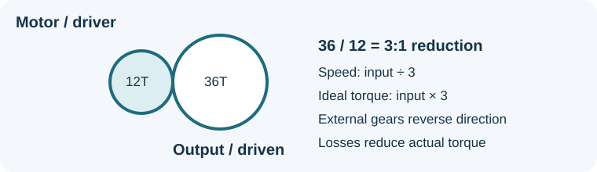
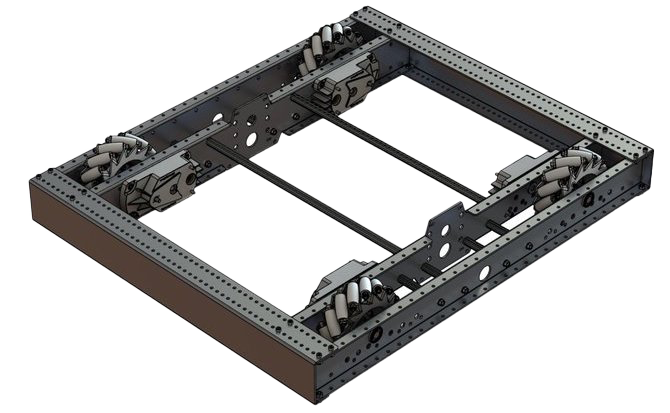

<!-- ai-assisted -->

# Mechanical ratios, interfaces, and serviceability

A mechanism converts motor motion into a useful action. Before selecting parts, define the task: distance, load, speed, available space, duty cycle, and what happens when the mechanism jams. Draw the **interfaces** as carefully as the mechanism: how does the shaft mount, where are loads supported, how are sensors referenced, and where can wires move without being pinched?

## Work a ratio

For two external gears, define reduction `G = driven teeth / driver teeth`. A 12-tooth driver turning a 36-tooth driven gear gives `G = 36 / 12 = 3`. If the input turns at 300 revolutions per minute, the output ideally turns at `300 / 3 = 100 rpm`, in the opposite direction. If input torque is 1 newton-metre (N·m), ideal output torque is `1 × 3 = 3 N·m`; actual output is lower because of losses. A gear reduction trades speed for torque; it does not create free power. Real motor torque and speed also depend on load, battery voltage, current limits and temperature.

For multiple stages, multiply the stage reductions, and track direction separately. Label which shaft each speed refers to. For a drum of effective radius `r`, a simple no-slip conversion is linear speed `v = ωr`, where angular speed `ω` is in radians per second and `r` is in metres. For example, at 10 rad/s and 0.05 m radius, `v = 0.5 m/s`. Cable layering or wheel slip changes the actual relationship. WPILib's [system identification guidance](https://docs.wpilib.org/en/stable/docs/software/advanced-controls/system-identification/analyzing-gains.html) emphasizes how encoder placement and gearing affect interpretation.

*WPILib's example of a mecanum chassis: inspect the shaft supports, frame mounting holes and motor locations when thinking about interfaces. This is a published rendering, not Team 1257 CAD or a source of fabrication dimensions. [WPILib drive classes](https://docs.wpilib.org/en/stable/docs/software/hardware-apis/motors/wpi-drive-classes.html), FIRST and WPILib contributors, [CC BY 4.0](https://creativecommons.org/licenses/by/4.0/).*

## Make the design maintainable

A mounting interface should specify hole pattern, material thickness, shaft diameter or profile, bearing locations, fastener access and clearance. Establish which dimensions come from a manufacturer, which were measured, and which are assumptions. In CAD, check full motion travel, fastener insertion, cable routing and component removal; a visually clear assembly is not proof of a clear motion envelope or sufficient strength. Document access to a failed motor or belt and a repeatable way to re-zero sensors after service. Review loads, guards and fabrication with an experienced engineer.

**Try it:** Sketch a two-stage reduction of 2:1 followed by 3:1. Calculate the total reduction (6:1), ideal output at 600 rpm input (100 rpm), and ideal output torque at 1 N·m input (6 N·m). Then mark two interfaces that must be measured and name two reasons a real test could differ. Finally, find one fastener that must be removed to replace the motor and check whether a tool can reach it.
