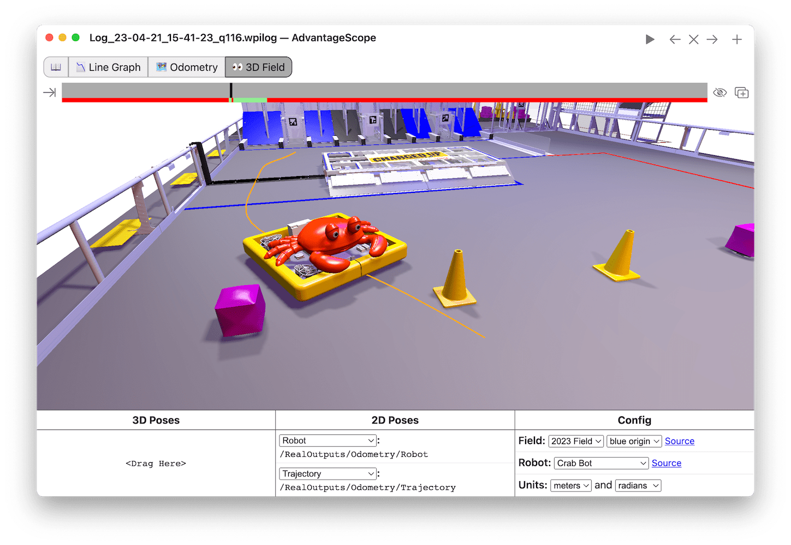

<!-- ai-assisted -->

# Strategy and scouting with uncertainty

A match plan connects the game's scoring opportunities to what an alliance can reliably do. Start with the season's official manual and team updates, then turn rules into questions: What actions score? When are they available? How do penalties, field access, and the other robots affect them? FIRST's [introduction to scouting](https://www.firstinspires.org/sites/default/files/uploads/resource_library/frc/team-resources/frc_intro_scouting.pdf) and [technical resources](https://www.firstinspires.org/resources/library/frc/technical-resources) introduce scouting and analysis.

A scout records observations to improve decisions, not merely to rank teams. Define each field before an event. For example, an **attempt** starts when the robot begins a scoring action; a **success** means the observer saw the specified result. Record match, team, event, observer, phase, attempt and success separately. Include a missing or uncertain value when the view is blocked. A blank is not automatically zero. Coordinate the definitions among scouts and compare a practice match together.

## Work an example

Suppose a scout sees 3 successes in 4 observed attempts by one robot. The observed rate is `3 / 4 = 75%`; the sample is small and excludes any attempts the scout could not see. Four observations do not establish that the robot will succeed 75% of the time in different conditions. If another observer counts two successes from the same video, preserve the disagreement and resolve the definition or visibility issue before using a single number. This is a made-up training example, not a team result.

Alliance scores and wins describe the alliance outcome, not one robot's causal contribution. Separate a directly recorded event from a model estimate and from a hypothesis: "we observed three successful attempts" differs from "a model estimates contribution" and from "this mechanism caused the win." Compare similar tasks, time windows, defense and teammates where possible. Avoid claiming precision that the data does not support.

*An AdvantageScope field display in WPILib documentation. It visualizes a selected pose and trajectory; it is not video, scouting observation, or a Team 1257 match. The illustrated 2023 field is historical: use the current game manual when planning. [Field visualization guide](https://docs.wpilib.org/en/stable/docs/software/dashboards/glass/field2d-widget.html), FIRST and WPILib contributors, [CC BY 4.0](https://creativecommons.org/licenses/by/4.0/).*

## Turn evidence into a plan

List a primary role and a fallback for each robot; check for conflicts over starting position, field space or game pieces. If one robot cannot perform its expected action, decide how the other two adapt. Show the drive team a short plan that can be acted on, and revise it when fresh observations contradict assumptions. Match strategy remains subject to current rules and event officials.

**Try it:** Design a six-field scouting form for a season-appropriate action. Include a way to express "not seen." Create two hypothetical match records with different levels of defense, calculate the observed success rates, and explain why the rates might not be comparable. Write one question for an alliance partner and one fallback plan.
