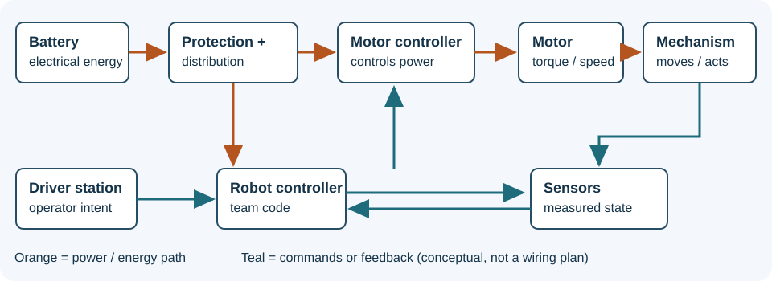

# Follow a signal through the robot

A robot takes operator intent and sensor measurements, decides what to do, and controls mechanisms using electrical energy. To troubleshoot effectively, follow both the **information path** and the **power path**: a valid command cannot move an unpowered motor, and a powered motor controller still needs an appropriate command. WPILib's [hardware overview](https://docs.wpilib.org/en/stable/docs/controls-overviews/control-system-hardware.html) describes the common components.

The orange arrows show a simplified power path. The battery supplies the robot through main protection and power distribution. The distribution system supplies loads including controllers and the robot controller. A motor controller regulates power delivered to its motor; the motor drives a mechanism through a mechanical interface. Exact connections depend on approved hardware and the current [FIRST game manual](https://firstfrc.blob.core.windows.net/frc2026/Manual/HTML/2026GameManual.htm); do not wire from this conceptual diagram.

The teal paths show information. The driver station sends operator input to the robot controller, which runs team code. That code can request a motor voltage, speed, or position. A motor controller acts on that request; sensors report quantities such as position, speed or contact. Depending on the system, feedback may go directly to a motor controller, to the robot controller, or through a network. A sensor value can be stale, disconnected, scaled incorrectly, or physically misleading, so label units and origin.

**Worked example:** A driver asks an intake to run. The binding schedules a command, the command requests an output, the controller applies voltage, and a motor turns rollers. If the command appears scheduled but nothing moves, first ask whether the robot is enabled, then compare requested output, controller status, actual voltage and mechanism motion. If the rollers spin but the object does not move, the control path alone cannot explain the entire problem: examine contact, alignment and loading safely.

**Try it:** Draw the information and energy paths for a pivot on your robot. Mark one observable value at each boundary, its unit, and the tool used to inspect it. Identify a failure that would appear at each boundary. Explain why "the code sent a command" and "the mechanism moved" are different claims. Then compare with the [2026 Team 1257 walkthrough](../robots/2026-code.md).
