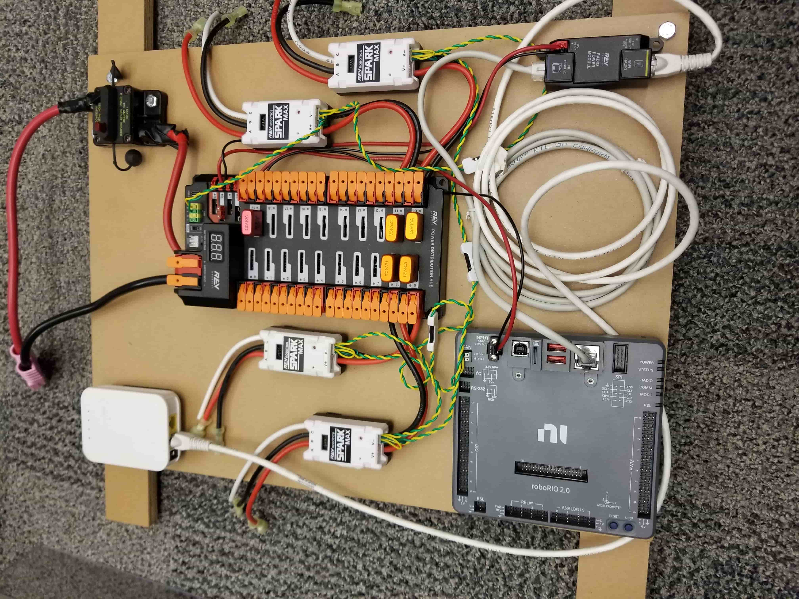
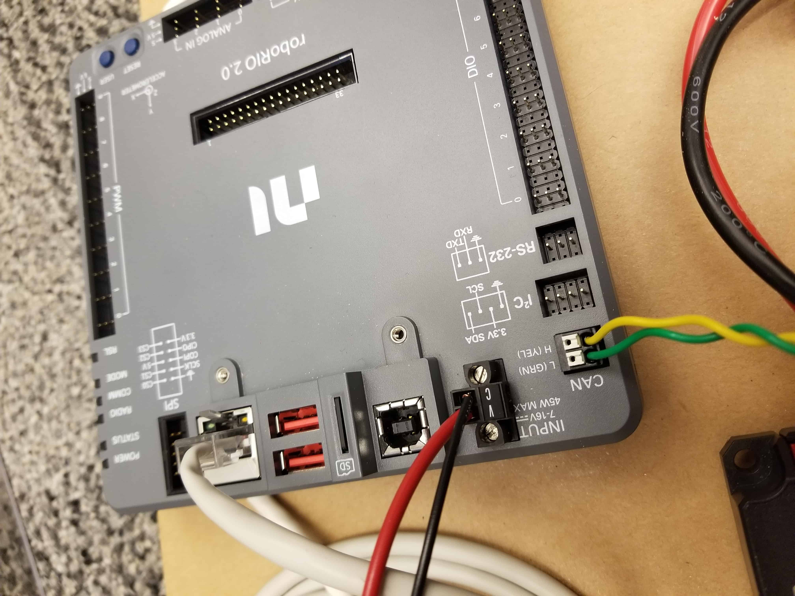
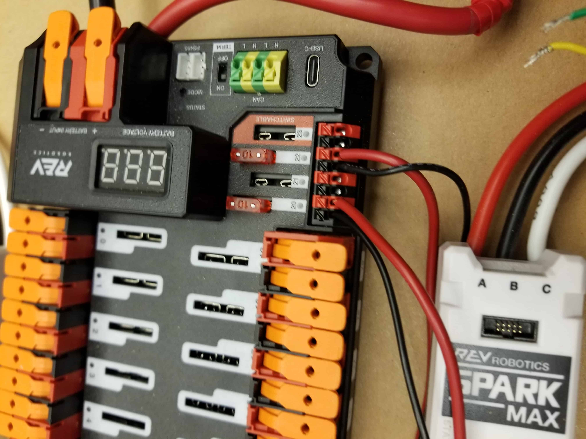
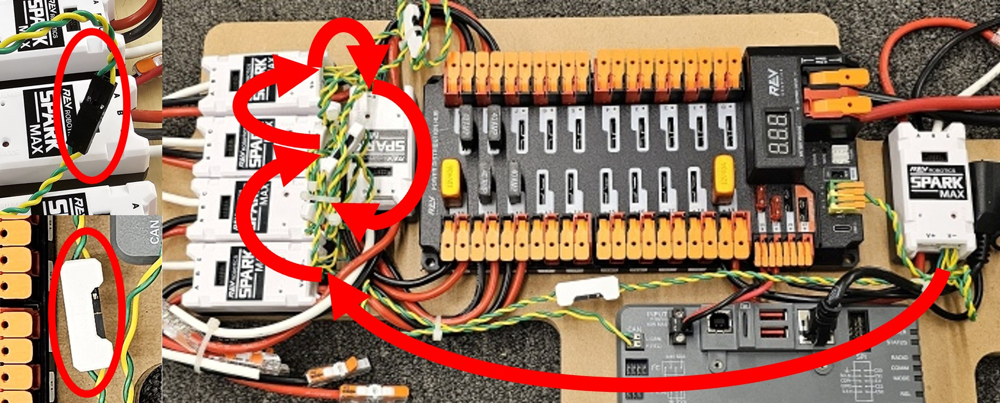

<!-- ai-assisted -->

# Follow power and signals through a robot

A driver asks the robot to act. The robot controller runs code, sends a request to a motor controller, and the motor turns a mechanism. Sensors can report what happened. A separate electrical path delivers energy to those devices. Follow both paths: a correct command cannot move an unpowered motor, and a powered controller still needs a valid command.

## Find the real components

*WPILib's photographed training layout. The roboRIO is at lower left, the power distribution hub is centered, the white motor controllers surround it, and the main breaker is at upper right. This is an instructional layout, not a photograph of Team 1257's robot. [WPILib wiring guide](https://docs.wpilib.org/en/stable/docs/zero-to-robot/step-1/intro-to-frc-robot-wiring.html), CC BY 4.0; location metadata removed.*

Look for the thick red and black power wires and the thinner twisted yellow and green communication pair. The white Ethernet cable connects the radio to the roboRIO. The red and black wires carry power; the yellow and green pair carries CAN messages. Use this example to learn the components, then compare it with your robot and the current FIRST and vendor instructions.

## Read the official system diagram

*REV control-system diagram courtesy of **FRC Team 3161 and Stefen Acepcion**, published in the [WPILib hardware overview](https://docs.wpilib.org/en/stable/docs/controls-overviews/control-system-hardware.html), [CC BY 4.0](https://creativecommons.org/licenses/by/4.0/). Select the diagram to open its full-size vector version and zoom in. Colors and device examples belong to this diagram; consult current instructions before wiring.*

The diagram shows a roboRIO, a radio, a distribution hub, motor controllers and examples of sensors. Its legend distinguishes power, CAN and PWM. Start at the battery and main protection, follow power to the distribution hub and a motor controller, then locate a separate command path from the controller to that device. A motor controller regulates electrical output to a motor; mechanical motion then depends on the motor and its load. CAN carries messages; it does not replace motor power wiring. Hardware and circuit arrangements vary by robot.

## Inspect the details

### Robot controller and CAN

*The roboRIO's labeled CAN connector in WPILib's example. The Ethernet, power and CAN connections have different jobs. [WPILib wiring guide](https://docs.wpilib.org/en/stable/docs/zero-to-robot/step-1/intro-to-frc-robot-wiring.html), CC BY 4.0; location metadata removed.*

The roboRIO runs team code. Ethernet connects it to the radio so the Driver Station can exchange control and status data. CAN connects it to devices such as motor controllers. Digital and analog inputs accept other sensor signals. In software, find the device object and its ID or port, then trace where the program reads a measurement or sends a request.

### Distribution and motor control

*The distribution hub and a nearby SPARK MAX in WPILib's training layout. [WPILib wiring guide](https://docs.wpilib.org/en/stable/docs/zero-to-robot/step-1/intro-to-frc-robot-wiring.html), CC BY 4.0; location metadata removed.*

The hub distributes battery power to protected branches. Follow one red/black pair from the orange hub terminals to a white SPARK MAX. The SPARK MAX has a separate set of wires going to its motor, and a yellow/green CAN pair carrying commands and status. This separation explains a common debugging puzzle: a controller can communicate while a motor or mechanism still has a problem. Check power, command, measured response and the mechanism in order.

### A communication chain

*WPILib's annotation follows CAN connections among devices in a training setup. [WPILib wiring guide](https://docs.wpilib.org/en/stable/docs/zero-to-robot/step-1/intro-to-frc-robot-wiring.html), CC BY 4.0.*

The yellow and green pair carries communication; the separate red and black conductors supply power. Device addressing, termination, wiring and protection must follow the current manual and relevant vendor instructions. See [electrical troubleshooting](electrical.md) for a step-by-step approach.

### Feedback is a measurement

*CTRE magnetic encoder shown in [WPILib's encoder overview](https://docs.wpilib.org/en/stable/docs/hardware/sensors/encoders-hardware.html), CC BY 4.0. It senses a magnet's orientation; it is one sensor example, not a claim about Team 1257's installed hardware.*

An encoder may help report position or speed. The physical sensor, its mounting, ratio, sign and software units determine what a reading means. A reported numerical zero does not by itself prove a mechanism is physically at home. Explore that distinction in the [encoder lab](../labs/encoder.html ':ignore').

## Practice: an intake that does not move

A driver holds the intake button, but the rollers do not turn. Work through the chain:

1. **Driver Station:** is the robot connected and enabled?
2. **Code:** is the intake command scheduled, and what output is requested?
3. **Controller:** does the intended CAN device appear, and what status or faults does it report?
4. **Power:** have a qualified teammate check the supply and protected branch using the team's approved procedure.
5. **Mechanism:** disable and isolate stored energy before inspecting a disconnected motor, jam or damaged transmission.

Write down each result before changing anything. A successful connection answers one question; it does not answer all five.

**Try it:** On the training-board photo, locate the roboRIO, distribution hub, motor controllers and breaker. On the diagram, trace one power connection and one communication connection. Make a table with one measurement, unit and tool at each boundary. Then trace an actual code path in the [2026 Team 1257 case study](../robots/2026-code.md), keeping source code separate from observed hardware behavior.

All source images above are from FIRST and WPILib contributors' documentation under [CC BY 4.0](https://creativecommons.org/licenses/by/4.0/); the diagram's individual credit is noted above. The repository retains source URLs, retrieval times, revisions, hashes and changes in its hardware media inventory.
