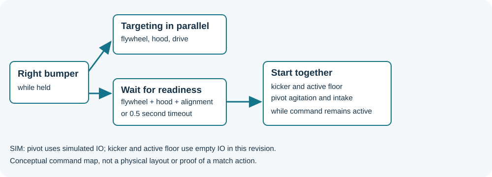

> **Historical lesson:** This material predates the 2026 course and may use older WPILib, vendor APIs, team wrappers, and game rules. Its original version is not verified here. Do not copy its robot code into a 2026 project without migration and mentor review. Start with [the 2026 subsystem lesson](../1-Basics/5-First_Subsystem.md).

# Command-Based

Ultimately, to organize our robot code, we use what is known as a **command-based** design pattern. In this framework, all mechanisms on our robot are grouped into what are known as `subsystems`, and each of these `subsystems` can run certain `commands`. In almost all cases, every action that our robot can perform will be a `command`.

## Subsystems

All subsystems on a robot are composed of actuators (motors/pistons) and sensors. However, we won't worry about sensors right now. For each of these subsystems, we will make a class inside of our `/subsystems` folder that represents it. For instance, we will make a file called `Intake.java`, and this class should extend `SnailSubsystem`. In this class, we will include all of the code to run the subsystem.

Each of these subsystems will have a few actions it can do with these actuators. For instance, a drivetrain can be moved with manual driver control. An intake could either intake or eject a game piece. An elevator can use either manual control or precise closed loop control to get to a specific position.

## Commands

Each of those aforementioned actions are known as a `command`. At any given time, a subsystem has a current command running on  it that tells us what this subsystem is currently doing. For instance, an intake subsystem would have multiple commands available to it such as running in its neutral state, ejecting, or intaking an object. At any point, the roller intake subsystem would have one of these three commands running on it, which would tell us what the intake should currently be doing.

We can set which command is currently running on our subsystem in two different ways. The first way we can do it is via setting one as the default command of a subsystem, which will run as long as no other commands are scheduled to run on the subsystem. The next way to set commands to a subsystem is to associate it with the press of a button.

For instance, the roller intake might be set up such that whenever nothing is being pressed on the controller, its default `command` is to run at a low, constant speed that is associated with the neutral position. Then, if the A button is pressed, we could schedule it to run an ejecting command, and when the B button is pressed, we might schedule it so that it runs an intaking command. When these buttons are released, we can end these commands, and then the default nuetral command would take over.

## CommandScheduler

The way WPILib handles everything command-based is through something known as the `CommandScheduler`. Its function is right in the name: it executes commands that are called, preventing conflicts between commands (e.g. stopping an elevator from moving up and down simultaneously), and removing completed or interrupted commands. We have to constantly call the `CommandScheduler` to make sure it actually reads our commands and sets the robot into action. Inside our `periodic` functions, or rather in Robot.java's `robotPeriodic()`, we will put the line `CommandScheduler.getInstance().run();`. As a result, the scheduler's `run()` method will be called once every 20 ms. Here is `Robot.java`:

```java
package frc.robot;

import edu.wpi.first.wpilibj.TimedRobot;
import edu.wpi.first.wpilibj2.command.CommandScheduler;

public class Robot extends TimedRobot {

    @Override
    public void robotInit() {

    }

    @Override
    public void robotPeriodic() {
        CommandScheduler.getInstance().run();
    }

    ...
}
```

> [!TIP]
> You don't have to worry about these intricacies with `CommandScheduler` however since they are already included in our `snail-robot-template` repository, but it is useful to know what is going on in here.

## Example command flow

The earlier general-purpose flowchart is no longer publicly accessible. This separately created diagram shows a specific **2026 team scoring command**, not a reproduction of that older chart. The right bumper starts targeting and a readiness wait; after readiness or a timeout, the sequence starts several mechanisms. See the [2026 code walkthrough](../../robots/2026-code.md) for the source and the simulation limitations.



The scheduler handles requirements and command lifecycle; team code supplies the bindings, actions, completion conditions and stop behavior. The 2026 example uses different subsystem implementations from the historical template discussed above.
