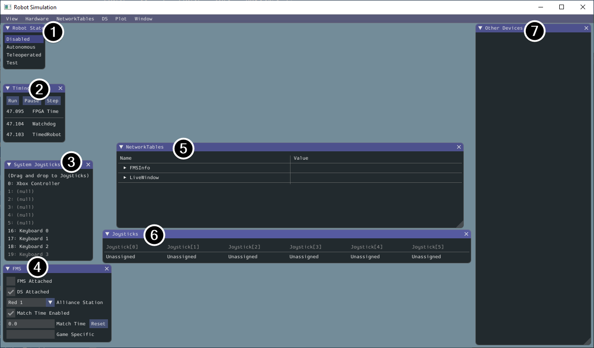

<!-- ai-assisted -->
# SubsystemIOSim: a model with explicit assumptions

**Prerequisites:** [IO interfaces](1-IO_Interfaces.md), velocity and sample periods. **Time:** 45 minutes. **Outcome:** explain the difference between deterministic model behavior and evidence about a physical robot.

An `IOSim` implements the same interface as real IO, but calculates input values from a model. In the runnable `RollerIOTraining.RollerIOSim`, the stored voltage is the previous control interval's input. On `updateInputs()` the model advances exactly 0.02 s and returns a new velocity and applied voltage. The educational equation is `dv/dt = (10 V − v) / 0.20 s`, where `v` is rad/s, `V` is volts, and `10` has units `(rad/s)/V`. This is an invented first-order model, not a measured Team 1257 mechanism. Its exact constant-input update is:

```text
v_next = v + (10 * voltage - v) * (1 - exp(-dt / 0.20))
```

If `v = 0`, `voltage = 10 V`, and `dt = 0.02 s`, the next velocity is about `9.516 rad/s`. The example clamps requested voltage to ±12 V and rejects non-finite requests. It assumes ideal voltage application, fixed time steps, no battery sag, noise, friction change, mechanical limits, or hardware communication. It advances when `updateInputs()` is called; calling it twice advances two steps. Production code should define which loop owns simulation advancement and avoid advancing a plant both there and in `simulationPeriodic()`.

## Read and calculate a step

This is the actual simulation implementation from the starter; the interface and `Inputs` record are on the previous page:

```java
public static final class RollerIOSim implements RollerIO {
    private double velocity;
    private double volts;

    @Override public Inputs updateInputs() {
        velocity += (10.0 * volts - velocity)
                * (1.0 - Math.exp(-DT_SECONDS / 0.20));
        return new Inputs(velocity, volts);
    }

    @Override public void setVoltage(double requested) {
        if (!Double.isFinite(requested))
            throw new IllegalArgumentException("voltage must be finite");
        volts = Math.max(-12.0, Math.min(12.0, requested));
    }
}
```

The surrounding class declares `DT_SECONDS = 0.02`. The following are calculated values from the example's 100 rad/s target, zero initial state and proportional gain 0.1. The `appliedVolts` column is the voltage used **during the interval ending at the sample**; the control calculation then supplies the following interval's voltage.

| `periodic` call | Sampled velocity (rad/s) | Sampled applied voltage (V) | Next requested voltage (V) |
| ---: | ---: | ---: | ---: |
| 1 | 0.000 | 0.000 | 10.000 |
| 2 | 9.516 | 10.000 | 9.048 |
| 3 | 17.221 | 9.048 | 8.278 |



*FIRST and WPILib contributors, [WPILib Robot Simulation](https://docs.wpilib.org/en/stable/docs/software/wpilib-tools/robot-simulation/introduction.html), [CC BY 4.0](https://creativecommons.org/licenses/by/4.0/). This is a documentation example, not a screenshot of the roller test above.*

## Compare the actual team simulator

The pinned [HopperIntakeIOSim](https://github.com/FRC1257/2026-Robot/blob/0c9a024dec1f58648d573ce26fcfd02639c5ca66/src/main/java/frc/robot/subsystems/Hopper/HopperIntake/HopperIntakeIOSim.java) constructs WPILib `FlywheelSim` using a motor and constants and advances it by `0.02` seconds in `updateInputs`. It populates leader voltage and velocity. Inspect the [inputs interface](https://github.com/FRC1257/2026-Robot/blob/0c9a024dec1f58648d573ce26fcfd02639c5ca66/src/main/java/frc/robot/subsystems/Hopper/HopperIntake/HopperIntakeIO.java): other fields exist but this implementation does not populate all of them. Default values are not simulated measurements. Check actual motor count, gearing, inertia, sensor units, and intended `stop` behavior in the project's code; do not infer physical accuracy from the class name.

WPILib also offers plant and device simulation APIs. Depending on the design, simulation code can advance a physics model and then inject sensor readings for subsequent control loops. Choose one integration location, define timing and initial conditions, and keep hardware-only API calls out of a simulation-only implementation. A fixed time step and fixed inputs make this small example repeatable, but deterministic code is not automatically accurate physics.

## Exercise

Run `./gradlew test --tests frc.robot.ArchitectureLessonsTest` in `examples/robot-starter`. The repeatability test runs two plants with equivalent clamped voltages; the ordering test checks the 0 V first sample and computed second sample. Predict the next sample for −10 V from rest: about −9.516 rad/s. Change the sample period only as a deliberate experiment and recompute the expected value; the fixed-period test should fail until its expectations are reconsidered.

Troubleshooting: no velocity change suggests no voltage was commanded or no update occurred; twice the expected motion suggests the plant is being advanced twice; a sensor that never disconnects may simply be missing from the model. Simulation success does not establish wiring, CAN configuration or safe physical operation. Sources: [WPILib physics simulation](https://docs.wpilib.org/en/stable/docs/software/wpilib-tools/robot-simulation/physics-sim.html), [device simulation](https://docs.wpilib.org/en/stable/docs/software/wpilib-tools/robot-simulation/device-sim.html), and the pinned team files above. Next: [logging and replay](3-Logging_Replay.md).
