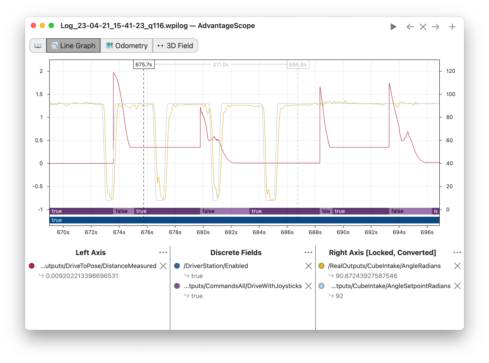

<!-- ai-assisted -->
# Logged inputs, outputs and replay

**Prerequisites:** [IO interfaces](1-IO_Interfaces.md), [simulation IO](2-Simulation_IO.md), and [logging](../5-Advanced_&_Misc/Advanced_Logging.md). **Time:** 45 minutes. **Outcome:** identify which data must be captured to reproduce a decision and explain the order of an AdvantageKit loop.

A log input is an observation entering the decision: sensor values, operator input, dashboard settings, network observations and time sources all matter. An output can be a requested voltage, state, error or computed setpoint. Recording an output is useful for diagnosis but cannot replace a missing input. Replaying a log means running code against recorded inputs; it is different from a physics simulation that generates new observations from a model. A real IO implementation should not be created during replay.

For the AdvantageKit IO pattern, the documented loop is:

```java
io.updateInputs(inputs);                 // hardware or simulation fills the cache
Logger.processInputs("Roller", inputs);  // record it, or populate it from replay
// Only now read inputs and perform the subsystem's decision.
```

This is an architecture excerpt, not a standalone class. In replay, `processInputs` can replace values with recorded values; doing control calculations before that call uses the wrong sample. Read the same cached values for the rest of the cycle. The team’s pinned [HopperIntake.periodic](https://github.com/FRC1257/2026-Robot/blob/0c9a024dec1f58648d573ce26fcfd02639c5ca66/src/main/java/frc/robot/subsystems/Hopper/HopperIntake/HopperIntake.java) shows `updateInputs`, then `Logger.processInputs`, then connection and current processing. The project pins AdvantageKit 26.0.0 in its [vendordep](https://github.com/FRC1257/2026-Robot/blob/0c9a024dec1f58648d573ce26fcfd02639c5ca66/vendordeps/AdvantageKit.json); this course's minimal starter does not include AdvantageKit.

`RollerIOTraining` uses an observer so its JUnit test can verify which immutable sample was published. It demonstrates ordering but **does not implement replay**, AdvantageKit logging, timestamps, or a real motor. For actual replay, follow the version-matched AdvantageKit configuration and logging setup. AdvantageKit's logging APIs are documented as main-thread-only; unsynchronized extra threads and unlogged randomness, files, dashboard or network values can make decisions differ. A log cannot reconstruct an input it never recorded. Even perfect decision replay does not establish what a modified command would physically do.

## Compare one loop in both examples

The following **illustrative AdvantageKit excerpt** shows the documented ordering. It requires the team's generated inputs class, configured logger and matching AdvantageKit dependency; it is not compiled in the minimal starter.

```java
io.updateInputs(inputs);                  // obtain the current device/model sample
Logger.processInputs("Roller", inputs);   // record, or replace with replayed sample
boolean connected = inputs.connected;    // use the post-process sample
// Decide and send an output using connected and other sampled values.
```

Compare that with the actual starter excerpt below. `inputObserver` receives a record for a unit test, but cannot replace it with logged data. Thus the two lines teach similar **ordering**, not equivalent replay capability.

```java
Inputs inputs = io.updateInputs();
inputObserver.accept(inputs);
io.setVoltage(0.1 * (targetRadPerSec - inputs.velocityRadPerSec()));
```

For the first two cycles in the simulation test, the observer receives `(0 rad/s, 0 V)` and then approximately `(9.516 rad/s, 10 V)`. It never receives the new request as though it were an earlier measurement. If the desired target, enable state or clock changes a decision, capture or deterministically provide that input in a real replay architecture too.



*FIRST and WPILib contributors, [WPILib plotting guide](https://docs.wpilib.org/en/stable/docs/software/dashboards/glass/plots.html), [CC BY 4.0](https://creativecommons.org/licenses/by/4.0/). This separate documentation example is not the team's 2024 recording.*

## Exercise

Use the [real 2024 log investigation](../../robots/2024-log.md). Identify one recorded input and timestamp, then name an output or test condition that is missing. The provided excerpt includes battery voltage and a module velocity but does not establish cause, robot displacement or a 2026 configuration. Trace how a logged velocity would be processed before a control decision in the example above. If a replay differs from the original, compare code revision, configuration, loop timing and all inputs before interpreting the difference as a control improvement.

Sources: [AdvantageKit IO interfaces](https://docs.advantagekit.org/data-flow/recording-inputs/io-interfaces/), [dashboard inputs](https://docs.advantagekit.org/data-flow/recording-inputs/dashboard-inputs/), [nondeterministic sources](https://docs.advantagekit.org/getting-started/common-issues/non-deterministic-data-sources/) and [multithreading](https://docs.advantagekit.org/getting-started/common-issues/multithreading/). Next: [interpolation tables](4-Interpolation_Tables.md).
