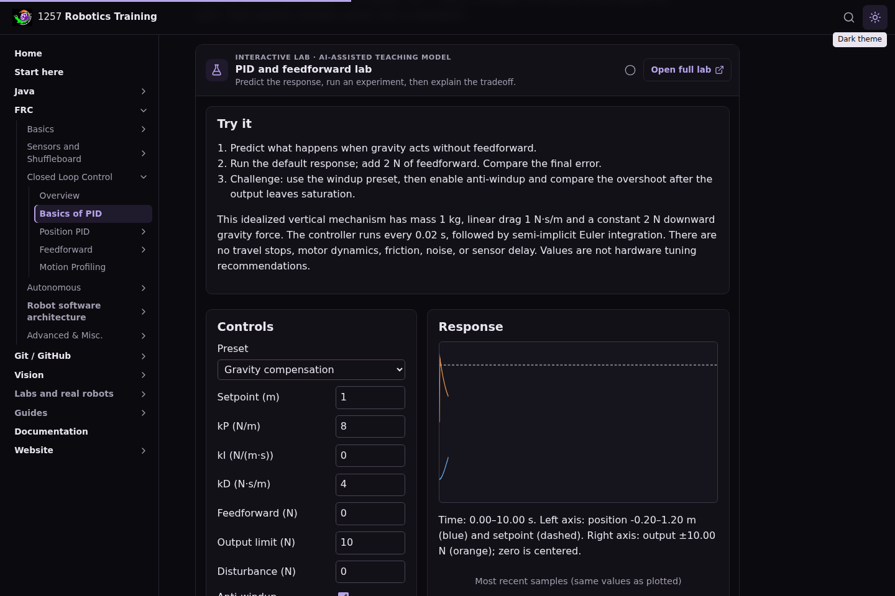
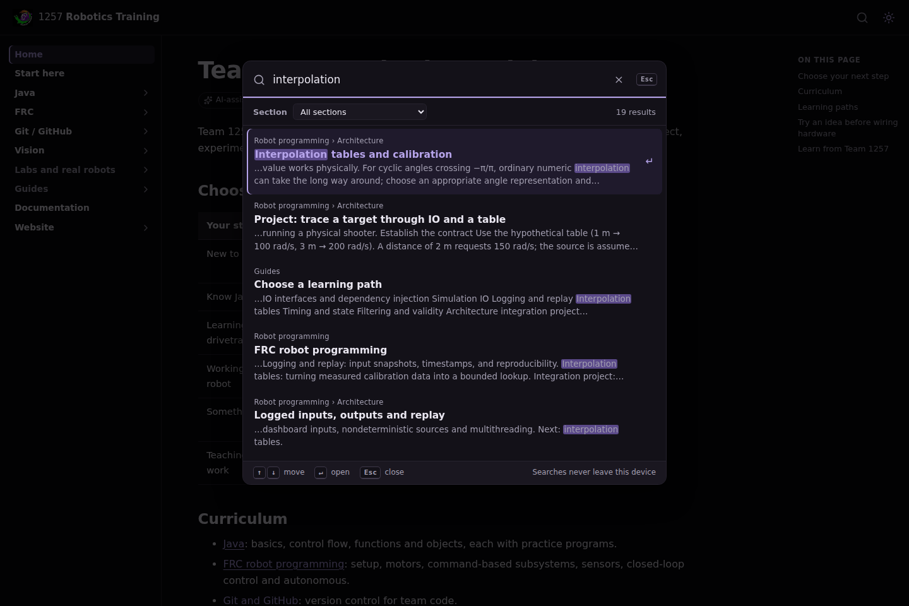

<!-- ai-assisted -->

# Explore a concept in the browser

Each lab pairs a question with controls, a visual result, and numbers you can inspect. Start with a prediction before changing a setting. Explain the result to another student and connect it to the matching code example.

## Swerve translation and rotation

Open the [swerve lab](../labs/swerve.html ':ignore'). With forward translation and zero rotation, every module should have the same velocity. Select rotation, disable steering optimization for the first comparison, and predict each corner's direction. Enable optimization and explain why the same physical velocity can use a negative wheel speed and a different steering angle.

<figure><figcaption>Unedited browser capture of this repository's lab at commit e09a4dc. The diagram describes ideal kinematics, not tire or motor dynamics. Select the image to inspect the full capture.</figcaption></figure>

## PID on a phone

Open the [PID lab](../labs/pid.html ':ignore'). The default plant has a constant downward load. Predict its final position with proportional feedback and no feedforward, then compare with the response after adding the stated gravity-compensation force. Use the sample table alongside the graph: error, requested output, and saturation are different quantities.

<figure><figcaption>Unedited mobile browser capture after resetting and stepping the lab 500 times at commit e09a4dc. The model is paused at ten simulated seconds; it reports 0.750 m position and a 0.250 m error with these default inputs. This is a teaching-model result, not a hardware measurement.</figcaption></figure>

## Experiment without leaving the lesson

The [PID lesson](../frc/3-Closed_Loop_Control/2-Basics_of_PID.md) contains the working lab. Its controls, model description and numerical results stay beside the explanation. The embedded lab follows the lesson's theme; use **Open full lab** for a larger workspace. Loading an embed does not automatically mark that lab complete.

*Unedited desktop viewport capture of this application at commit e09a4dc. This is the actual teaching model rendered in the lesson, not a photograph of a robot.*

## Find a concept or code pattern

Open search with the magnifying glass, **Ctrl/⌘ K**, or `/`. Try `SubsystemIOSim`, `interpolation tables` or a symptom such as `robot not moving`. Use the section filter, arrow keys and Enter to open a result. Escape closes the palette; the clear icon resets the query. Searches stay in your browser.

*Unedited desktop viewport capture at commit e09a4dc, searching the actual generated lesson index.*

## Investigate a real recording

The [log explorer](../labs/log.html ':ignore') loads a small excerpt from a real 2024 Team 1257 recording. Start with [the source exercise](../robots/2024-log.md), identify the enabled interval, and compare the separate signal timestamps. This is a different kind of evidence from the synthetic PID and odometry models. The excerpt cannot establish transient peaks or a cause for a voltage change.

These screenshots were produced by the [desktop/mobile CI browser run](https://github.com/FRC1257/robotics-training/actions/runs/42957979637), rather than generated as mockups. Their hashes and capture revision are retained in the repository's source inventory. The captures identify the exact tested revision.
