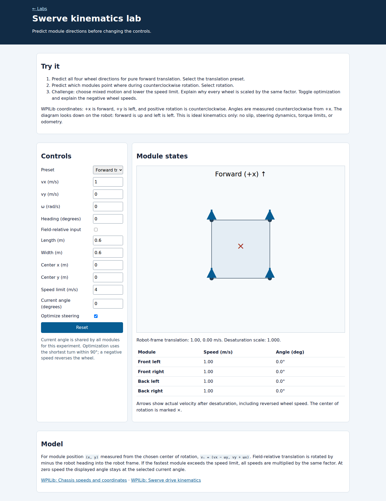
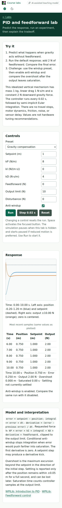

<!-- ai-assisted -->

# Explore a concept in the browser

Each lab pairs a question with controls, a visual result, and numbers you can inspect. Start with a prediction before changing a setting. Explain the result to another student and connect it to the matching code example.

## Swerve translation and rotation

Open the [swerve lab](../labs/swerve.html ':ignore'). With forward translation and zero rotation, every module should have the same velocity. Select rotation, disable steering optimization for the first comparison, and predict each corner's direction. Enable optimization and explain why the same physical velocity can use a negative wheel speed and a different steering angle.

<figure><figcaption>Unedited browser capture of this repository's lab at commit 9ea99c1. The diagram describes ideal kinematics, not tire or motor dynamics. Select the image to inspect the full capture.</figcaption></figure>

## PID on a phone

Open the [PID lab](../labs/pid.html ':ignore'). The default plant has a constant downward load. Predict its final position with proportional feedback and no feedforward, then compare with the response after adding the stated gravity-compensation force. Use the sample table alongside the graph: error, requested output, and saturation are different quantities.

<figure><figcaption>Unedited mobile browser capture of the running lab at commit 9ea99c1. Exact displayed values depend on capture time; use pause and single-step to make your own repeatable comparison.</figcaption></figure>

## Investigate a real recording

The [log explorer](../labs/log.html ':ignore') loads a small excerpt from a real 2024 Team 1257 recording. Start with [the source exercise](../robots/2024-log.md), identify the enabled interval, and compare the separate signal timestamps. This is a different kind of evidence from the synthetic PID and odometry models. The excerpt cannot establish transient peaks or a cause for a voltage change.

These screenshots were produced by the [desktop/mobile CI browser run](https://github.com/FRC1257/robotics-training/actions/runs/42945983264), rather than generated as mockups. Their hashes and capture revision are retained in the repository's source inventory. Current labs may include additional navigation and progress controls.
