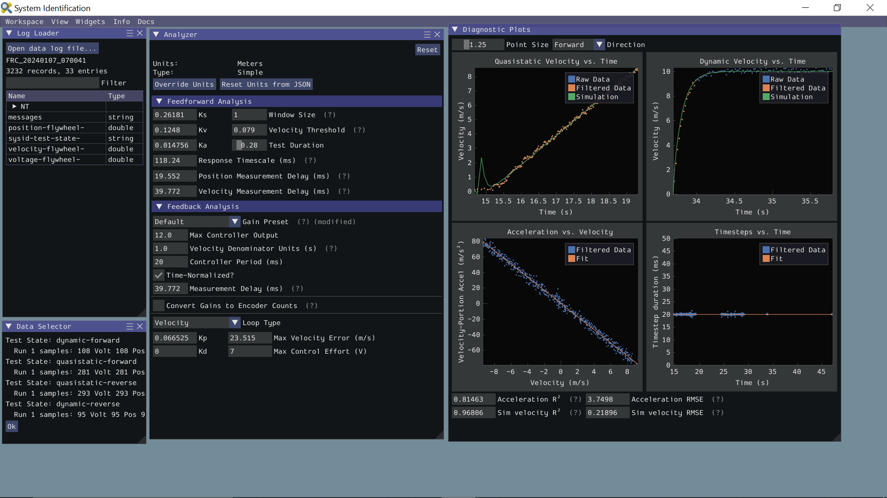

<!-- ai-assisted -->

# Integration projects: build, measure, explain

Use these projects after the linked lessons. Work in pairs or across subteams. Each project has a concrete handoff and a check for understanding. Browser labs are simplified teaching models; historical code is a source snapshot; neither establishes a real robot's performance. Time ranges are rough self-paced estimates and do not include hardware fabrication or mentor scheduling.

## 1. A Java readiness check

**Starting point:** [Java practice](../java/Textbook_Practice.md), [methods](../java/3-Functions/1-Basics.md) and [classes](../java/4-Objects/2-Classes.md). **Estimate:** 45–75 minutes.

Write a small Java console program with a method that returns whether a mechanism is ready from three inputs: `enabled`, `sensorHealthy`, and `speedError`. Define readiness for this exercise as enabled AND sensor healthy AND absolute speed error below 0.5 rad/s. Keep the threshold named and include units in your description. Print a clear result for each test; do not connect it to robot hardware.

**Expected examples:** `(true, true, 0.3)` is ready; `(true, false, 0.3)`, `(false, true, 0.3)` and `(true, true, 0.5)` are not ready. The last case checks the strict boundary. Also test a negative error. These are invented input values for a programming exercise.

**Deliver:** source file, compile/run command, actual output, and one paragraph explaining how the threshold and tests work. Have a partner change a condition and identify the first test that catches the change. If you could not run it, provide your predicted output and explicitly mark execution as pending.

## 2. An intake and scheduler handoff

**Starting point:** [first subsystem](../frc/1-Basics/5-First_Subsystem.md), [command bindings](../frc/1-Basics/5d-Binding_Commands.md), and [scheduler lab](../labs/scheduler.html ':ignore'). **Estimate:** 90–150 minutes.

Trace a hold-to-run intake command through binding, requirement, output, interruption and stop. Predict the scheduler lab sequence when a second command requiring the same subsystem starts, then step through it and record what actually happens. In a suitable simulation project, implement or adapt the intake and verify the stop behavior on release and interruption. If the environment is unavailable, submit the scheduler observation and pseudocode with simulation marked untested.

**Deliver:** a one-page state sequence with each command's start and end, the subsystem it requires, expected output on release, and the lab's observed steps. Include the code or pseudocode and one failure case, such as a command that does not stop its output. Distinguish a command stopping from a motor physically stopping under load. A mentor should review any later hardware test.

## 3. Controls and a real 2024 log

**Starting point:** [encoder lab](../labs/encoder.html ':ignore'), [PID lab](../labs/pid.html ':ignore'), [2024 log provenance](../robots/2024-log.md), and [log explorer](../labs/log.html ':ignore'). **Estimate:** 75–120 minutes.

First predict how a larger proportional gain changes the model response. Change one input in the PID lab and compare the plotted result; record saturation and the lab's limits. Separately inspect the Team 1257 2024 excerpt: mark enabled transitions and locate the voltage and module velocity samples. Keep these two investigations separate: the lab is a model, while the 2024 data comes from a historical recording.

**Expected check:** the log records enabled `True` at 19,307,236 µs and voltage approximately 11.66 V at 19,690,089 µs. These are independent samples, not proof that enabling caused the voltage change. The excerpt is sparse; it cannot identify transient peaks. Use the linked original recording and metadata for any deeper analysis.

**Deliver:** a prediction, a before/after table of lab settings and observed model response, two source-labeled log observations with units and timestamps, and three unanswered questions. Include a sketch of which additional signals and test conditions could distinguish competing explanations. Do not infer a match outcome, robot displacement, or a causal relationship from this excerpt.

*WPILib's SysId documentation example shows analysis inputs and diagnostic plots. Its data and gains are unrelated to the 2024 log exercise; do not copy them to a robot. [WPILib software overview](https://docs.wpilib.org/en/stable/docs/controls-overviews/control-system-software.html), FIRST and WPILib contributors, [CC BY 4.0](https://creativecommons.org/licenses/by/4.0/).*

## 4. Review a 2026 command chain as a team

**Starting point:** [2026 code walkthrough](../robots/2026-code.md), [system map](../foundations/system.md), [electrical](../foundations/electrical.md), [mechanical](../foundations/mechanical.md), and [safety](../foundations/safety.md). **Estimate:** 90–120 minutes.

Have software, electrical and mechanical reviewers jointly trace the right-bumper scoring command in the pinned source. Draw a conceptual path from button to flywheel/hood readiness wait and the parallel feed commands. Mark the 0.5-second timeout and identify what is and is not implemented in the simulation IO. The exact source revision is linked in the walkthrough; this is code inspection, not a claim about a competition match.

**Deliver:** a diagram with code links; an interface table with each requested output, a possible feedback signal and its unit; a list of unverified assumptions; and a controlled test proposal. The plan should name operator, stop procedure, area and stored-energy controls, mentor review, success criterion and what data would be recorded. Do not deploy or energize a mechanism solely from this exercise.

## Shared review rubric

| Criterion | Ready for review | Needs another pass |
| --- | --- | --- |
| Correctness | Predictions and actual results are separate; units, boundaries and calculations are explicit. | Results lack a test, units, or an explanation of mismatches. |
| Traceability | Code and data identify the source revision or file and distinguish model, recorded data and hypothesis. | A simulated or historical result is presented as present robot behavior. |
| Communication | A teammate can reproduce the steps and understand the deliverable and limitations. | Steps, assumptions or observed outputs are missing. |
| Safety and handoff | A hardware test requires a mentor-reviewed plan with energy controls and stop authority. | The exercise assumes simulation or software alone makes hardware safe. |

Ask a partner to point to one piece of evidence for each conclusion and one issue that remains open. Reviewers can request a revision or accept a clearly documented limitation; an unrun test is not a passed test.
