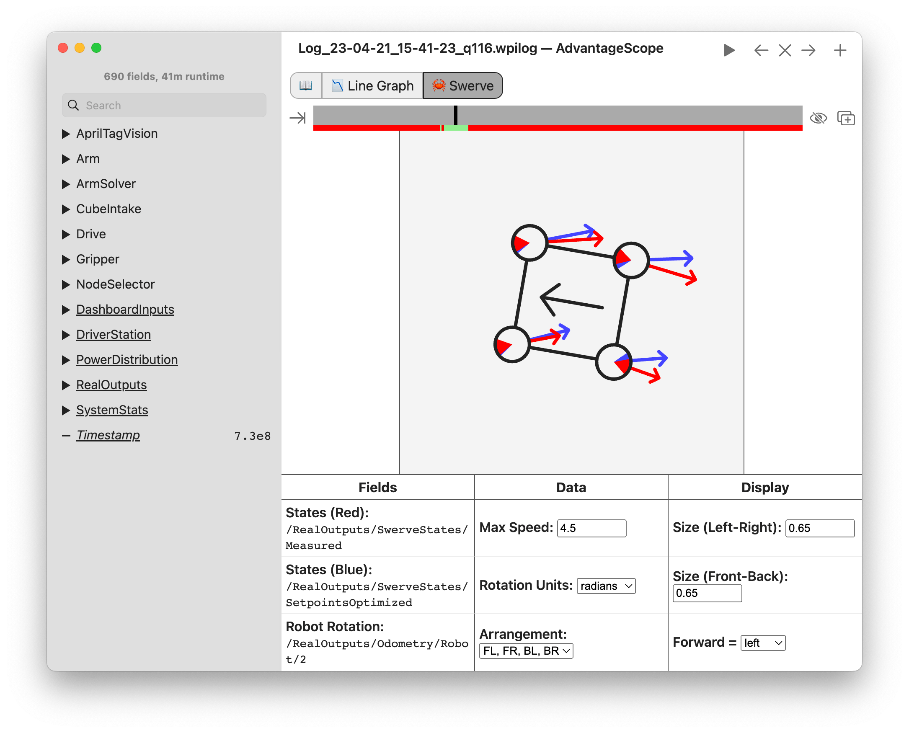

<!-- ai-assisted -->

# Program differential and swerve drive

Team 254's [2022 binder](https://media.team254.com/2022/10/8f2407a5-Team_254_Tech_Binder_2022.pdf), pages 13–19, describes an MK4i swerve drivetrain (`E22-254-BINDER`); Team 1678's [2026 robot page](https://www.citruscircuits.org/2026-robot) describes MK5n swerve (`E26-1678-ROBOT`). The research concepts also propose differential drive where an existing simpler base suits the job; those are **unbuilt choices**, not claims that the cited robots used differential drive or that one drive type won a match.



*In this separate WPILib documentation example, red and blue arrows show measured and optimized setpoint states; it is not a log from either team-season above. Confirm module order and coordinate frame before interpreting a display. [WPILib swerve kinematics](https://docs.wpilib.org/en/stable/docs/software/kinematics-and-odometry/swerve-drive-kinematics.html), FIRST and WPILib contributors, [CC BY 4.0](https://creativecommons.org/licenses/by/4.0/).*

## Translate a motion request

With differential drive, software controls left and right wheel velocities; turning requires a speed difference, and ideal sideways translation is unavailable. With swerve, each module has a steering angle and drive speed, permitting translation and rotation together within physical limits. Both need motor control, measured wheel distance/speed, a gyro heading, consistent signs and stop behavior. Swerve adds steering absolute/relative encoders, module ordering, offsets and calibration. A wrong module order can make correct-looking math command the wrong corner.

Use metres, metres/second, radians and radians/second consistently. With WPILib's +x forward, +y left, positive counterclockwise convention, field-relative requests must be transformed using the estimated robot heading. At +90° heading, field-forward corresponds to robot-right. A stale or unzeroed heading changes the answer. [WPILib swerve kinematics](https://docs.wpilib.org/en/stable/docs/software/kinematics-and-odometry/swerve-drive-kinematics.html) describes the geometry; the [swerve lab](../labs/swerve.html ':ignore') provides a simplified interactive model.

**Illustrative pseudocode — not executable:**

```text
validate heading, wheel/module health and enabled state
if field_relative: robot_speeds = rotate(field_speeds, -heading)
if differential: reject unsupported lateral request; solve left/right speeds
if swerve: solve speed + angle for each known module location
constrain achievable speeds; send ordered outputs
update odometry from measured sensors; log request, measurements and quality
```

Wheel odometry can drift or slip. Vision may correct an estimator if the pose, frame, capture timestamp and uncertainty are suitable; a close simulated trace is not independent ground truth. Autonomous adds an initial pose, path frame, trajectory constraints, cancellation and a recovery route for missed acquisition. Refer to the [Team 1257 2026 code walkthrough](../robots/2026-code.md) for a concrete pinned system.

## Exercise

Predict pure forward motion and pure rotation before running the lab. Verify each swerve module's direction and compare measured versus requested states, then intentionally reverse the assumed gyro sign in a model and describe the field-relative error. Inject a stale gyro and ensure the intended fallback is explicit. Simulated kinematics do not demonstrate traction, collision avoidance, mechanical alignment or hardware safety.

## Try the kinematics

In this idealized swerve lab, predict the module vectors for pure translation, then pure rotation. The lab computes wheel vectors, not tire contact, traction or a particular team's drivetrain. Compare its robot-relative and field-relative modes before designing autonomous code.

<!-- lab: swerve -->
