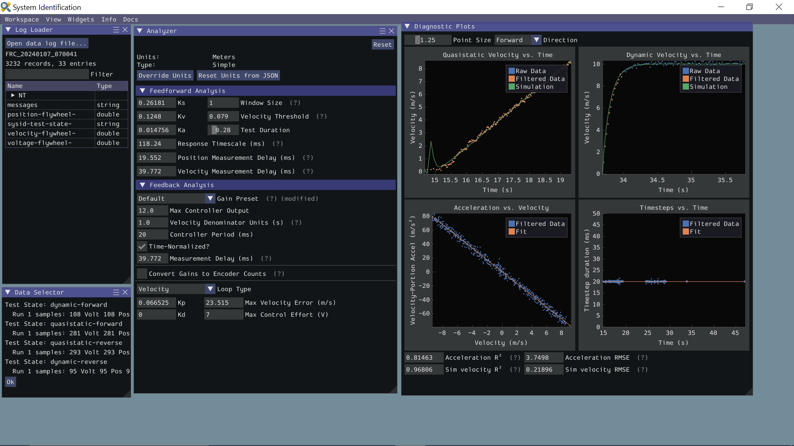

<!-- ai-assisted -->

# Program a chassis-aimed shooter

A fixed-heading shooter aims largely by turning the drivetrain, so shooting readiness depends on **two subsystems**: the launcher must reach the requested speed and the chassis must face the target. A fixed-heading scorer appears as an unbuilt candidate in the research synthesis; it is not presented as a tested copy of a particular team. For context, Team 1678 describes an adjustable-hood shooter and color-sorting indexer on its [2022 robot page](https://www.citruscircuits.org/2022-robot) (`E22-1678-ROBOT`); that source does not establish this lesson's fixed-heading software.

## Define signals and ownership

A shooter IO layer reports wheel velocity in rad/s, applied voltage, current and device status. Drive IO/estimation supplies robot heading in radians, pose in metres and a timestamp; a piece sensor supplies a boolean and any separately available diagnostic status. A single digital input level usually cannot distinguish an inactive sensor from a broken wire; sensor validity requires suitable hardware diagnostics and system-level checks, and may remain unknown. The controller receives a target and computes a speed/heading solution appropriate to the current calibration. Each subsystem owns its actuator; a coordinating command requests goals and declares requirements instead of making multiple commands fight over the same motors. Do not confuse a wheel speed setpoint with actual speed or a camera observation with a verified field pose.



*This separate WPILib SysId example shows diagnostic plots and analysis parameters; its displayed data and gains are not from the hypothetical shooter or the 2022 robot. [WPILib software overview](https://docs.wpilib.org/en/stable/docs/controls-overviews/control-system-software.html), FIRST and WPILib contributors, [CC BY 4.0](https://creativecommons.org/licenses/by/4.0/).*

## Design the sequence

**Illustrative pseudocode — not executable and not team code:**

```text
IDLE -> ACQUIRE when requested
ACQUIRE -> AIM when piece_confirmed
AIM: request heading and shooter speed
AIM -> FEED when operator_requests AND target_valid AND
  heading_in_tolerance AND speed_in_tolerance AND piece_confirmed
FEED -> RECOVER when piece_departure_confirmed
any state -> FAULT on stale required sensor, timeout, or explicit abort
```

For a real design add debounced readiness, named units, bounds, release timing, fallback and a safe response to sensor loss. A single beam break may show presence at its location but cannot by itself prove an object was successfully scored. Motion compensation and a range-to-speed table are separate improvements that require calibrated measurements. Autonomous should reuse the same readiness contract, define its starting pose, and have a timeout or safe alternative if a piece is not acquired. Driver confirmation may be useful, but a software flag is not a physical interlock.

## Practice and tests

In fake IO or simulation, feed a speed trace that reaches target, then make the required heading stale. Expect a transition from `AIM` to `FAULT` and inhibited feed. Restore a fresh heading, explicitly acknowledge and clear the fault under the reviewed recovery policy, then re-enter `AIM`; feed becomes eligible only after all readiness conditions are satisfied. Inject a missing departure sensor and verify timeout and recovery are visible. Track requested/actual speed, heading error, sensor age and state transitions. A simple plant model can test ordering and logic; it cannot establish shot accuracy, actual ball contact or safe tuning. Compare this contract with the [turreted shooter](turret-shooter.md): what changes if chassis heading no longer directly determines barrel heading?

## Predict, experiment, explain

**Predict:** Can a ready flywheel feed while the chassis is still misaligned? What should happen after one modeled piece has fed?

**Experiment:** Enable the model, set speed to `200 rad/s`, target heading to `3 rad` and mark the piece detected, then request a shot. After about 1.5 s the wheel is within its 4% speed tolerance but heading is about 2.25 rad; the aim gate is false and feed remains zero. Around 2 s the heading reaches the target and feeding becomes eligible. After one modeled feed interval, the phase becomes `spent`; clear the piece-detected input before representing another piece. Exact timing depends on the simulator step and UI speed.

**Inject a fault:** Make the required sensor stale while the request remains held. Inspect the latched fault and requested outputs; clear the condition, release the request, then reset before a new request. The ideal model stops the flywheel immediately on disable; this does not model physical coast-down.

**Explain:** Which readiness gate delayed feeding, and why is a feed request not evidence of a scored piece? Compare the conceptual stages with the linked team method. The browser model does not execute that Java; the cited 2024 robot used a turret, while chassis aiming is this lesson's adaptation.

**Compare the source:** [Team 254 2024 `AimFactory.java`](https://github.com/Team254/FRC-2024-Public/blob/040f653744c9b18182be5f6bc51a7e505e346e59/src/main/java/com/team254/frc2024/command_factories/AimFactory.java#L50-L67). The source checks shooter speed, turret angle, hood angle and solution validity, then combines them. Shooter speed uses RPS; angles use radians. The demo adapts this idea and does not implement the source method.

<!-- lab: mechanism-fixed-shooter -->
