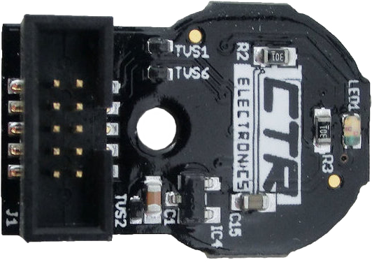

<!-- ai-assisted -->

# Program a pivoting telescoping arm

Team 2910's [2023 technical discussion](https://www.chiefdelphi.com/t/2910-cad-and-tech-binder-release-2023/436653) describes a pivoting, extendable arm, cone-offset sensing, AprilTag relocalization and release checks; the team says strict checks sometimes delayed a skilled driver (`E23-2910-RELEASE`). Its [2025 public code README](https://github.com/FRCTeam2910/2025CompetitionRobot-Public) describes state-based scoring and climbing coordination (`2025-2910-code`). These are separate team-seasons and descriptions, not independent success-rate measurements or the exact implementation below.



*WPILib shows a magnetic encoder as one way to sense a shaft's position. This is a generic sensor example, not evidence that either cited Team 2910 robot used this device. [WPILib encoder overview](https://docs.wpilib.org/en/stable/docs/hardware/sensors/encoders-hardware.html), FIRST and WPILib contributors, [CC BY 4.0](https://creativecommons.org/licenses/by/4.0/).*

## Compute an endpoint, then constrain it

The state estimate needs shoulder angle in radians, extension in metres, wrist angle, measured piece offset, chassis pose and pitch, plus validity and timestamps. In an **ideal planar teaching model**, an endpoint relative to the shoulder is `(L cos θ, L sin θ)` where `L` is effective length and `θ` shoulder angle. A real wrist, piece offset, frame transform, backlash and flex add terms; the diagram is not verified robot geometry. Endpoint position alone does not establish safe loading, collision clearance or tip margin.

A planner can define a reviewed low travel pose, move shoulder toward a clear band, extend only when allowed, align the endpoint, then release and retract. Large extension increases the load moment and changes mass distribution; choose acceleration, reachable poses and fallback with mechanical review. If shoulder and extension are shared with climb, represent that resource dependency explicitly: simultaneous commands must not fight for the same actuator.

**Illustrative pseudocode — not executable and not Team 2910 code:**

```text
if unhomed or sensor_stale: inhibit_automatic_motion; request_reviewed_hold
plan = choose_safe_intermediate_poses(current, requested_goal)
move_shoulder_to_clear_band()
when shoulder_in_band and pitch_acceptable: extend_within_envelope()
continuously monitor clearance, limits, pitch and sensor freshness during motion
if clearance_lost or required_sensor_stale: stop/inhibit; enter reviewed recovery
when endpoint_ready and piece_confirmed and driver_confirms: release()
on_timeout_or_abort: enter_reviewed_recovery_state()
```

Readiness should expose which condition is blocking progress. A tighter threshold can reduce releases with large estimated error yet increase wait time; validate both rather than assuming stricter is always better. Pose vision requires a trusted capture time and accepted field transform; if unavailable, use a deliberately reviewed reduced-assistance mode rather than inventing a position.

## Exercise

For an assumed 1 m effective arm at 0 radians, the ideal endpoint is `(1, 0) m`; at π/2 it is approximately `(0, 1) m`. Inject an invalid extension encoder, a loss of clearance during motion, and an out-of-band shoulder while a long reach is requested: the fake IO test should inhibit extension and report the reason. Then simulate a false camera jump and verify no release is authorized solely from that update. An ideal geometric model cannot prove that a real arm will resist gravity, clear its wiring, or retain a load when disabled.

## Predict, experiment, explain

**Predict:** For the same shoulder angle, what happens to endpoint reach as the arm extends? What should happen if a required sensor becomes stale during motion?

**Experiment:** With the request released, enable and record the simulated asserted home switch, choose target shoulder angle and extension, then request movement. Inspect the endpoint, phase, clearance gate and requested outputs. Introduce a stale sensor or obstruction and observe the latched fault; release the request and clear the condition before reset.

**Explain:** Use the planar endpoint equation above to distinguish the position calculation from the safety decision. Compare the model’s conceptual stages with the linked team method: the browser does not execute that Java or establish real load capacity. The home control records an assumed switch event, not an automatic homing movement.

**Compare the source:** [Team 2910 2025 `ArmSubsystem.java`](https://github.com/FRCTeam2910/2025CompetitionRobot-Public/blob/1b9e161c7719da0522ec826e2a48d2afb63232a5/src/main/java/org/frc2910/robot/subsystems/arm/ArmSubsystem.java#L218-L230). In this branch, the arm requests shoulder angle and holds extension at zero until the measured shoulder is near its desired angle. The demo adapts this idea and does not implement the source method.

<!-- lab: mechanism-telescoping-arm -->
