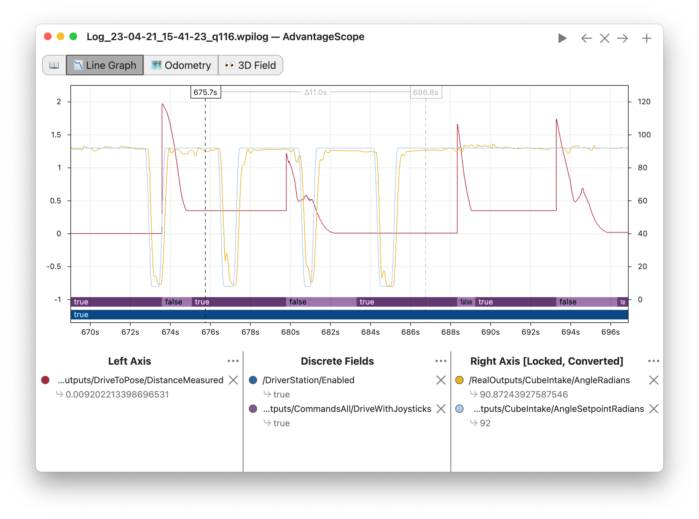

<!-- ai-assisted -->

# Investigate a real 2024 recording

This exercise uses Team 1257's [2024-Logs recording](https://github.com/FRC1257/2024-Logs/blob/686c0d0f14ac1ce2d2c71fd57ca9d5b5c903a5dd/Week-of-1-29/Log_24-02-01_16-45-53.wpilog). The team's [README](https://github.com/FRC1257/2024-Logs/blob/686c0d0f14ac1ce2d2c71fd57ca9d5b5c903a5dd/README.md) calls the collection 2024 AdvantageKit logs; its [license](https://github.com/FRC1257/2024-Logs/blob/686c0d0f14ac1ce2d2c71fd57ca9d5b5c903a5dd/LICENSE) is the Unlicense. The filename and folder do not establish what test was performed. This is not a 2025 or 2026 recording.

[Download the small CSV excerpt](../media/robots/2024-log-excerpt.csv) or open the original `.wpilog` in AdvantageScope. The excerpt retains native microsecond timestamps, with all recorded enabled changes and at most one numeric sample per signal per second. Signals are independent streams, not synchronized rows. The data was extracted with [this hash-checking script](../media/robots/extract_log.py); source hash, software version and scope are in the [inventory](sources.md).

| Signal | Meaning for this exercise | Unit |
| --- | --- | --- |
| `/DriverStation/Enabled` | Recorded enable state | boolean |
| `/SystemStats/BatteryVoltage` | Recorded system battery voltage | volts |
| `/Drive/Module0/DriveVelocityRadPerSec` | Reported drive module 0 angular velocity | radians/second |

At timestamp **19,307,236 µs**, the log records enabled `True`. At **19,690,089 µs** the excerpt records battery voltage about **11.66 V**. At **20,434,111 µs** the excerpt records module 0 velocity about **0.044 rad/s**. These are separate samples: their proximity alone does not establish cause, robot displacement, or a match result. Startup gaps and sparse samples can hide events; inspect the full file before drawing conclusions.

*WPILib's separate AdvantageScope example illustrates plotting numerical signals and discrete states against time. It is **not** the Team 1257 2024 recording or the excerpt above. Read labels, units and timestamps before comparing traces. [WPILib plotting guide](https://docs.wpilib.org/en/stable/docs/software/dashboards/glass/plots.html), FIRST and WPILib contributors, [CC BY 4.0](https://creativecommons.org/licenses/by/4.0/).*

## Guided investigation

1. Plot each numeric signal against `timestamp_us / 1,000,000`. Mark both enabled transitions. Do not join separate streams solely by row number.
2. Compare voltage before and during the enabled interval. What additional current, motor-command and test-context signals would you need to investigate a voltage change?
3. Compare the module velocity with the other three module velocities in the full log. What else is needed to infer chassis motion? Angular velocity is not distance traveled.
4. Check the original recording at higher resolution before reporting peaks or a timing relationship. The CSV deliberately discards most samples and cannot identify transient maxima.

<!-- lab: log -->

**Capture your own:** Confirm storage and logging are configured for the actual project, identify which code revision and configuration are deployed, and record test conditions and safety setup. After the test, preserve the original log unchanged, note its provenance, and make a separate analysis copy. Use a controlled test, not an assumption about what a field means.
