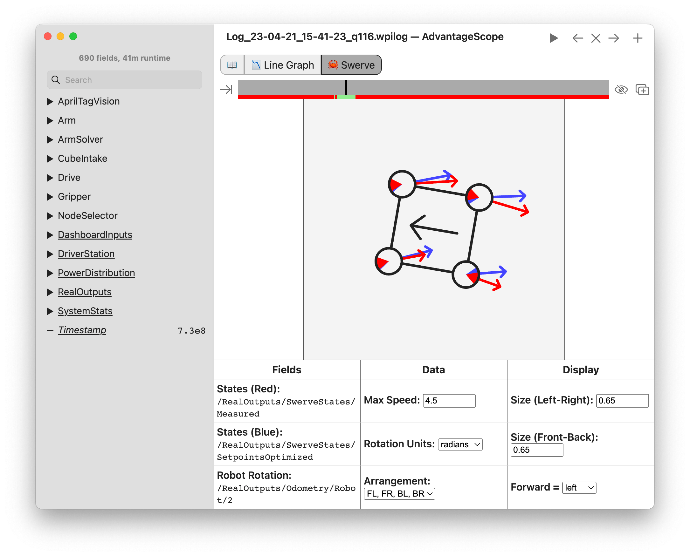

<!-- ai-assisted -->

# Reading Team 1257's 2025 robot code

This walkthrough refers to [2025-Robot at commit `944e460`](https://github.com/FRC1257/2025-Robot/tree/944e4602061d51e6d2c02b08d6d680a89712f091), whose repository contains component-specific license files. GitHub identifies an AdvantageKit license as GPL-3.0; no single top-level `LICENSE` for all team code was found. We link to the code rather than copying it into this training site. A commit is a snapshot, not proof of what ran at a particular event.

**Baseline:** [build.gradle](https://github.com/FRC1257/2025-Robot/blob/944e4602061d51e6d2c02b08d6d680a89712f091/build.gradle) specifies GradleRIO 2025.3.1 and Java 17. The pinned vendor files list [AdvantageKit 4.1.2](https://github.com/FRC1257/2025-Robot/blob/944e4602061d51e6d2c02b08d6d680a89712f091/vendordeps/AdvantageKit.json), [REVLib 2025.0.3](https://github.com/FRC1257/2025-Robot/blob/944e4602061d51e6d2c02b08d6d680a89712f091/vendordeps/REVLib.json), [Phoenix 6 25.3.1](https://github.com/FRC1257/2025-Robot/blob/944e4602061d51e6d2c02b08d6d680a89712f091/vendordeps/Phoenix6-25.3.1.json), [PathPlanner 2025.2.6](https://github.com/FRC1257/2025-Robot/blob/944e4602061d51e6d2c02b08d6d680a89712f091/vendordeps/PathplannerLib-2025.2.6.json), and [PhotonLib v2025.2.1](https://github.com/FRC1257/2025-Robot/blob/944e4602061d51e6d2c02b08d6d680a89712f091/vendordeps/photonlib.json). These are historical versions, not a recommendation for a new project.

## Follow one cycle

1. In [Robot.java](https://github.com/FRC1257/2025-Robot/blob/944e4602061d51e6d2c02b08d6d680a89712f091/src/main/java/frc/robot/Robot.java), the constructor configures logging and creates `RobotContainer`; `robotPeriodic()` runs the command scheduler. The scheduler is the recurring point where commands and subsystem periodic methods get time.
2. [RobotContainer.java](https://github.com/FRC1257/2025-Robot/blob/944e4602061d51e6d2c02b08d6d680a89712f091/src/main/java/frc/robot/RobotContainer.java) chooses real, simulated, or replay-oriented IO implementations according to mode. For example, the real elevator uses `ElevatorIOSparkMax`; simulation uses `ElevatorIOSim`. The same subsystem can therefore consume inputs from different implementations.
3. In [Elevator.java](https://github.com/FRC1257/2025-Robot/blob/944e4602061d51e6d2c02b08d6d680a89712f091/src/main/java/frc/robot/subsystems/elevator/Elevator.java), `periodic()` updates and logs inputs. `setPID()` bounds the requested goal using constants, and `runPID()` checks position, velocity and a limit switch before calling the IO controller. Read conditions carefully: software checks are not a substitute for physical safety design.
4. In [ElevatorIOSparkMax.java](https://github.com/FRC1257/2025-Robot/blob/944e4602061d51e6d2c02b08d6d680a89712f091/src/main/java/frc/robot/subsystems/elevator/ElevatorIOSparkMax.java), `setSetpoint()` sets and resets the profiled controller. `goToSetpoint()` combines PID and feedforward, clamps the sum to ±12 V, and calls `setVoltage()`; the latter logs desired voltage. Find the encoder conversion and motor configuration before interpreting any measurement.

**Try it:** Starting with `runPID()`, trace the calls until voltage reaches the motor. Which values are measured, which are requested, and which are calculated? Draw three columns and put each variable in one. Notice that `Elevator.periodic()` calls `processInputs` twice in this snapshot; observe the code rather than assuming the duplicate is intentional.

## Drive and autonomous

[Drive.java](https://github.com/FRC1257/2025-Robot/blob/944e4602061d51e6d2c02b08d6d680a89712f091/src/main/java/frc/robot/subsystems/drive/Drive.java) configures PathPlanner's `AutoBuilder`, updates drive and gyro inputs in `periodic()`, records setpoints, and includes pose estimation and vision measurement handling. `runVelocity()` converts chassis motion requests into module setpoints. Compare requested setpoints with measured states before diagnosing tracking.

The container constructs a dashboard chooser **and** a custom chooser, but `getAutonomousCommand()` actually returns `customAutoChooser.getAutoCommand()` in this revision. Read [CustomAutoChooser.java](https://github.com/FRC1257/2025-Robot/blob/944e4602061d51e6d2c02b08d6d680a89712f091/src/main/java/frc/robot/util/autonomous/CustomAutoChooser.java) and the deployed [PathPlanner assets](https://github.com/FRC1257/2025-Robot/tree/944e4602061d51e6d2c02b08d6d680a89712f091/src/main/deploy/pathplanner) together. The existence of a path does not prove it was selected or executed.

*WPILib's separate AdvantageScope example displays measured module states in red and optimized setpoints in blue. It is an illustration of the comparison, **not a log from this 2025 Team 1257 snapshot**. Confirm module order, units and coordinate frame in your own data. [WPILib swerve kinematics](https://docs.wpilib.org/en/stable/docs/software/kinematics-and-odometry/swerve-drive-kinematics.html), FIRST and WPILib contributors, [CC BY 4.0](https://creativecommons.org/licenses/by/4.0/).*

## Logging and replay

`Robot.java` records build metadata. In real mode it configures a WPILOG writer at `/media/sda1/` and an NT4 publisher; simulation writes to `sim_logs/`; replay reads a selected log and writes a suffixed output. The checked-in `sim_logs` directory is labeled simulation, not a match recording. To understand actual recorded data, use the separate [2024 log exercise](2024-log.md). Verify the selected mode, hardware, storage, and current team procedure before a test.
