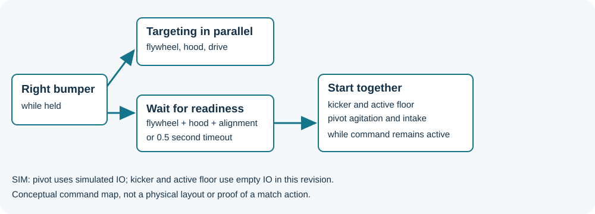
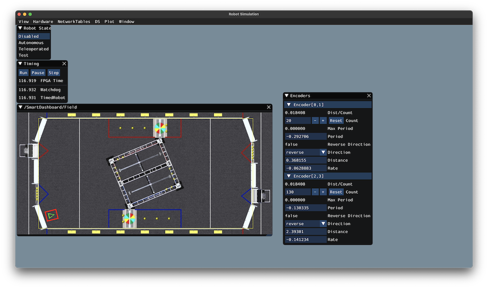

<!-- ai-assisted -->

# Trace the 2026 robot: commands, mechanisms and simulation

This case follows Team 1257's [2026-Robot commit `0c9a024`](https://github.com/FRC1257/2026-Robot/tree/0c9a024dec1f58648d573ce26fcfd02639c5ca66). Its [build](https://github.com/FRC1257/2026-Robot/blob/0c9a024dec1f58648d573ce26fcfd02639c5ca66/build.gradle) specifies Java 17 and GradleRIO 2026.2.1; vendor files specify [AdvantageKit 26.0.0](https://github.com/FRC1257/2026-Robot/blob/0c9a024dec1f58648d573ce26fcfd02639c5ca66/vendordeps/AdvantageKit.json), [REVLib 2026.0.0](https://github.com/FRC1257/2026-Robot/blob/0c9a024dec1f58648d573ce26fcfd02639c5ca66/vendordeps/REVLib.json) and [PhotonLib v2026.1.1-rc-2](https://github.com/FRC1257/2026-Robot/blob/0c9a024dec1f58648d573ce26fcfd02639c5ca66/vendordeps/photonlib.json). Treat these as a historical snapshot; it does not establish what binary or configuration ran at an event.

The original illustration maps code relationships, not physical placement, and does not show a measured robot. Read [RobotContainer's real and simulation branches and button bindings](https://github.com/FRC1257/2026-Robot/blob/0c9a024dec1f58648d573ce26fcfd02639c5ca66/src/main/java/frc/robot/RobotContainer.java) alongside it.

## Start with a driver action

Holding the driver's right bumper runs flywheel and hood targeting alongside drive alignment. In parallel, the code waits for flywheel, hood and drive alignment readiness **or a 0.5-second timeout**, then runs kicker, active floor, pivot agitation and hopper intake together. The timeout matters: the code can advance without all readiness conditions becoming true. Releasing the button ends the held command; read the individual command end behavior before assuming what every output does after cancellation.

The left bumper uses hub velocity and angle with a similar 0.5-second readiness timeout, while the right trigger runs hopper intake. The pivot default is `runIntakeAngle()`; active floor and intake default to stop commands. These statements describe the code, not observed match behavior.

## Follow three mechanisms to hardware

| Mechanism | Subsystem and command | Real IO and feedback |
| --- | --- | --- |
| Active floor | [`ActiveFloor.runActiveFloor()`](https://github.com/FRC1257/2026-Robot/blob/0c9a024dec1f58648d573ce26fcfd02639c5ca66/src/main/java/frc/robot/subsystems/ActiveFloor/ActiveFloor.java) supplies a constant voltage through a ±12 V clamp; `periodic()` logs inputs and a debounced disconnect alert. | [`ActiveFloorIOSparkMax`](https://github.com/FRC1257/2026-Robot/blob/0c9a024dec1f58648d573ce26fcfd02639c5ca66/src/main/java/frc/robot/subsystems/ActiveFloor/ActiveFloorIOSparkMax.java) actually constructs a **SparkFlex** despite its class name. It reports applied voltage, encoder speed, current and temperature. Its encoder conversion has a `NEEDS TO BE DETERMINED` comment: don't assume the conversion describes the final mechanism. |
| Kicker | [`Kicker.runIntake()`](https://github.com/FRC1257/2026-Robot/blob/0c9a024dec1f58648d573ce26fcfd02639c5ca66/src/main/java/frc/robot/subsystems/Kicker/Kicker.java) delegates to a velocity command, which stops IO when it ends. `isJammed()` combines a velocity threshold and current threshold with rising debounce. | [`KickerIOSparkMax`](https://github.com/FRC1257/2026-Robot/blob/0c9a024dec1f58648d573ce26fcfd02639c5ca66/src/main/java/frc/robot/subsystems/Kicker/KickerIOSparkMax.java) configures a SparkMax and a closed-loop setpoint with feedforward. Read the conversion factors and the units used by both sides before interpreting the controller's target. The jam trigger's existence does not show that any particular command uses it. |
| Hopper pivot | [`HopperPivot.runAngleCommand()`](https://github.com/FRC1257/2026-Robot/blob/0c9a024dec1f58648d573ce26fcfd02639c5ca66/src/main/java/frc/robot/subsystems/Hopper/HopperPivot/HopperPivot.java) clamps a goal, advances a trapezoid profile, logs goal and setpoint, and passes position and velocity to IO. `runAgitate()` alternates two angle commands on timeouts. | [`HopperPivotIOSparkMax`](https://github.com/FRC1257/2026-Robot/blob/0c9a024dec1f58648d573ce26fcfd02639c5ca66/src/main/java/frc/robot/subsystems/Hopper/HopperPivot/HopperPivotIOSparkMax.java) configures the right motor to follow the left with inversion; its angle method uses position control plus arm feedforward. It reads both motors' feedback. |

A commanded voltage, encoder speed and estimated position answer different questions. Neither code constants nor this diagram are measurements of the built robot or dimensions for fabrication.

## What simulation can and cannot exercise

The `SIM` branch constructs [`HopperPivotIOSim`](https://github.com/FRC1257/2026-Robot/blob/0c9a024dec1f58648d573ce26fcfd02639c5ca66/src/main/java/frc/robot/subsystems/Hopper/HopperPivot/HopperPivotIOSim.java), which steps a model, publishes a Mechanism2d and calculates voltage for the simulated angle. It also creates simulated hopper intake, flywheel, hood, drive modules and vision. **Kicker and active floor instead receive empty IO implementations in this branch.** The separately present [`KickerIOSim`](https://github.com/FRC1257/2026-Robot/blob/0c9a024dec1f58648d573ce26fcfd02639c5ca66/src/main/java/frc/robot/subsystems/Kicker/KickerIOSim.java) is empty at this revision and is not wired into the branch. A simulation that runs the command scheduler therefore cannot validate kicker or active-floor physical behavior here. This walkthrough inspects source; it does not claim a build or simulation was run.

*This separate WPILib drivetrain simulation example shows a field view and encoder values. It does **not** depict the 2026 Team 1257 pivot or prove its simulation has been run. [WPILib drivetrain simulation tutorial](https://docs.wpilib.org/en/stable/docs/software/wpilib-tools/robot-simulation/drivesim-tutorial/odometry-simgui.html), FIRST and WPILib contributors, [CC BY 4.0](https://creativecommons.org/licenses/by/4.0/).*

## Trace an autonomous selection

`getAutonomousCommand()` returns the custom [AutoChooser](https://github.com/FRC1257/2026-Robot/blob/0c9a024dec1f58648d573ce26fcfd02639c5ca66/src/main/java/frc/robot/util/autonomous/AutoChooser.java). `LEFT_TRENCH` sets a start pose, waits for the pivot goal, races a named path against intake, follows another path and calls `targetedScore()`. [Path files](https://github.com/FRC1257/2026-Robot/tree/0c9a024dec1f58648d573ce26fcfd02639c5ca66/src/main/deploy/pathplanner/paths) exist in the same snapshot. The chooser describes intended scheduling; it is not evidence of an executed path. Unlike the driver bumper's readiness wait, `targetedScore()` waits for flywheel and hood readiness without the 0.5-second timeout shown in the binding.

## Exercises

1. **Read a command group.** Identify the commands that run in parallel under the right bumper and identify the condition that starts the feed mechanisms. What happens when the timeout expires first? Compare `targetedScore()` in auto.
2. **Follow the pivot signal.** Make a table for requested goal, profiled setpoint and measured angle. Find where each originates and where each is logged. Why could setpoint and measurement differ?
3. **Inspect a simulation gap.** Compare real and sim constructor arguments in `RobotContainer`. Propose a minimal kicker simulation that records a target and updates a speed; define a test that would fail if its IO were still empty. Do not treat a model as hardware validation.
4. **Review sequencing.** In the `DEPOT` branch, find the standalone `hopperPivot.runIntakeAngle()` between two groups. Inspect whether that command has a completion condition before assuming the following path starts. Verify in a safe simulation before changing competition behavior.
