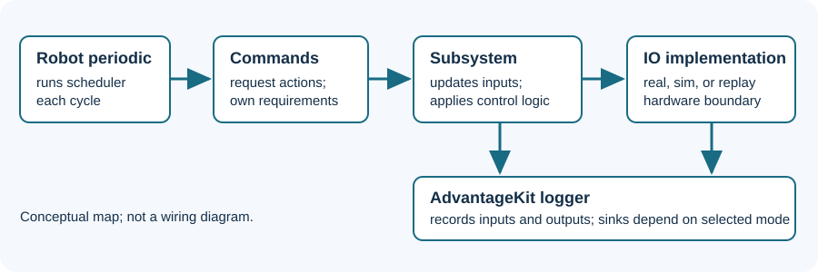

# Team 1257 robot case studies

Use a real robot project to connect concepts from the lessons to code. The 2025 and 2026 walkthroughs use separate pinned season snapshots; do not assume their configurations or dependencies match. Follow the links to inspect the exact source before adapting anything.

1. [2026 robot walkthrough](2026-code.md): follow active floor, kicker, pivot, autonomous and simulation.
2. [2025 code walkthrough](2025-code.md): trace scheduler, subsystem, hardware IO, elevator control, autonomous and logging.
3. [Investigate a real 2024 log](2024-log.md): work with a small extracted dataset and the original recording.
4. [Source and media inventory](sources.md): revisions, hashes, permissions and evidence gaps.

This original diagram summarizes the linked 2025 code. It is neither a photograph nor a physical wiring schematic. No robot CAD or photo has been republished here: a public repository alone does not establish image reuse permission, and the sources inspected did not establish a reusable, dimensioned CAD model. Ask the team for the current design and permissions before using CAD or photographs. A CAD model or code constant alone does not establish a built robot's final dimensions.
